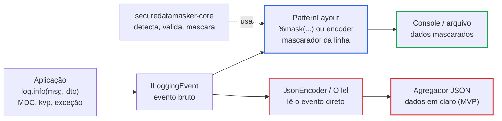

# SecureDataMasker — Especificação Técnica (Fase 1: Discovery)

Nov 4, 2026 · @Jhon Wesley

## Sumário executivo

O projeto é viável e útil, mas só se for posicionado como **redução de risco**, não como garantia: um `Converter` do Logback protege apenas o texto que passa por um `PatternLayout`, e uma parte relevante dos logs modernos (JSON, OpenTelemetry, exceções anexadas implicitamente) passa por fora dele.

Recomendação central, detalhada nas seções seguintes:

- **Dois módulos Maven**: `core`, sem dependências em runtime (validação, normalização, detecção e mascaramento), e `logback`, uma camada fina de integração.
- **Tipos de valor seguros por padrão**: `Cpf`, `Cnpj`, `Email` etc. cujo `toString()` já devolve o valor mascarado. Isso ataca a causa do vazamento (logar o objeto), não apenas o sintoma (texto já formatado).
- **Integração Logback em dois níveis**: um *composite converter* `%mask(...)` e um encoder que mascara a linha inteira já renderizada, este último para fechar o bypass do `%ex` implícito.
- **CNPJ alfanumérico desde o primeiro dia**: o formato está em produção desde julho de 2026, e um validador que só aceita dígitos já nasceria defasado.
- **Detecção sem regex de backtracking**: um scanner linear escrito à mão, com tempo O(n) garantido, elimina ReDoS por construção.

**Legenda usada no documento:**

| Marca | Significado |
| --- | --- |
| **\[Fato\]** | Comportamento verificável de Java, Logback, normas da Receita Federal ou do Bacen |
| **\[Hipótese\]** | Suposição plausível que ainda precisa ser confirmada (medição, prova de conceito ou sua resposta) |
| **\[Proposta\]** | Decisão que eu recomendo; vale até você aprovar ou trocar (as pendentes estão consolidadas na seção 17) |

## 1. Análise crítica da proposta

A ideia central é boa, mas três premissas da proposta original não se sustentam como estão escritas e precisam ser ajustadas antes da arquitetura.

### 1.1 Premissas que precisam de correção

1. **"Impedir que dados sejam expostos em logs" é uma promessa forte demais.** \[Fato\] Um `ClassicConverter` só atua sobre o texto que um `PatternLayout` renderiza. Ficam fora dele: encoders JSON (o `JsonEncoder` nativo e o `logstash-logback-encoder`), appenders que leem o `ILoggingEvent` direto (o appender do OpenTelemetry, por exemplo) e qualquer saída que não passe pelo Logback (`System.out`, Log4j2, agentes de APM). A formulação honesta é *"reduzir a exposição acidental nos destinos que usam PatternLayout, com limites documentados"*.
2. **"Validação de chave Pix" é, na prática, composição.** \[Fato\] Uma chave Pix é um CPF, um CNPJ, um e-mail, um telefone em E.164 (`+55...`) ou um UUID (EVP). O validador de Pix deve reutilizar os outros e acrescentar apenas as regras do DICT: e-mail em minúsculas com no máximo 77 caracteres, telefone com `+55` e CPF/CNPJ somente com dígitos. A biblioteca só consegue validar o **formato**. Se a chave existe, só se sabe consultando o DICT, o que é restrito a participantes do Pix e está fora do escopo.
3. **Os formatos de máscara do exemplo vazam mais do que parece.** `u*****@exemplo.com` mostra o tamanho do usuário quando o número de asteriscos acompanha o original. Mostrar os dois últimos dígitos do CPF revela exatamente os dígitos verificadores, que são função dos nove primeiros: pouca informação, mas não zero. \[Proposta\] Máscara de **comprimento fixo** e política padrão conservadora; revelação parcial só por configuração explícita (decisão D5).

### 1.2 O problema difícil não é validar, é detectar

Validar um CPF que já se sabe ser um CPF é trivial, e o algoritmo do módulo 11 é determinístico. O trabalho real está em **encontrar** dados sensíveis em texto livre:

- &#91;Fato\] Uma sequência de 11 dígitos pode ser CPF, celular com DDD, número de pedido ou timestamp. Exigir dígito verificador válido elimina cerca de 99% dos falsos positivos aleatórios (dois DVs, 1 chance em 100), mas deixa de mascarar CPFs digitados com erro, que continuam sendo dado pessoal.
- &#91;Fato\] Um celular como `11912345684` pode ser, ao mesmo tempo, um CPF válido e um telefone válido. O mascaramento não precisa resolver essa ambiguidade (mascara-se de qualquer forma), mas o formato da máscara sim.
- &#91;Fato\] O CNPJ alfanumérico (12 caracteres `[0-9A-Z]` + 2 DVs numéricos) se parece com identificadores comuns: hashes, IDs de pedido, códigos de produto. Sem a validação do DV, a detecção em texto livre seria inutilizável por excesso de falsos positivos.

Há portanto um **trade-off explícito entre segurança (mascarar mais) e observabilidade (não destruir IDs úteis)**, e ele deve ser configurável por tipo (decisão D4).

### 1.3 O que o Logback já oferece, e por que a biblioteca ainda se justifica

&#91;Fato\] O Logback já tem `%replace(%msg){'regex', 'subst'}`. Qualquer equipe consegue mascarar CPF formatado com uma regex e zero dependências. A biblioteca só se justifica se entregar o que o `%replace` não entrega:

- detecção com validação de DV (menos falsos positivos);
- política por tipo, documentada e testada;
- garantia de tempo linear (sem ReDoS);
- tipos de valor seguros para usar no código de domínio;
- cobertura do `%ex` e do MDC;
- CNPJ alfanumérico correto.

Esse é o argumento de valor do README.

### 1.4 Riscos do próprio produto

- **Superfície de cadeia de suprimentos.** \[Fato\] A biblioteca enxerga todas as mensagens de log da aplicação. Uma versão comprometida seria um exfiltrador perfeito. Por isso: zero dependências em runtime no `core`, releases assinadas, SBOM e proveniência.
- **Falsa sensação de segurança.** \[Hipótese\] O maior risco prático é o usuário instalar, ver CPFs mascarados no console e supor que o JSON enviado ao Elasticsearch também está protegido. Mitigação: a seção de limites aparece no topo do README, e o encoder emite um aviso de status na inicialização quando detecta configuração insegura (por exemplo, `%ex` fora do `%mask`).
- **Custo no caminho quente.** \[Hipótese\] O mascaramento roda em todo evento de log. Sem um *fast path* (pular mensagens sem dígito e sem `@`), o custo pode ser perceptível em serviços com muito log. Isso precisa ser medido com JMH, não presumido.

## 2. Problema, público-alvo e casos de uso

**Problema:** aplicações Java que tratam dados de brasileiros escrevem CPF, CNPJ, e-mail, telefone e chaves Pix em logs sem querer: logam um DTO inteiro, interpolam o payload de uma requisição, propagam uma exceção cuja mensagem contém o valor. Esses logs vão para agregadores (ELK, Loki, Datadog) com retenção longa e acesso amplo, o que contraria os princípios de necessidade e segurança da LGPD.

**Público-alvo primário:** equipes de backend Java/Spring Boot em fintechs, e-commerce, saúde, SaaS B2B e órgãos públicos brasileiros que já usam Logback (padrão do Spring Boot).

**Público secundário:** quem precisa apenas validar e normalizar documentos brasileiros sem nenhuma relação com logging. Por isso o `core` precisa funcionar sozinho.

**Fora do público-alvo:** quem precisa de DLP corporativo, descoberta de PII em bases de dados ou anonimização com garantias formais. São outros produtos.

### Casos de uso

| # | Ator | Caso de uso | Componente |
| --- | --- | --- | --- |
| UC1 | Dev | Validar e normalizar um CPF/CNPJ recebido numa API antes de persistir | `core` (validation) |
| UC2 | Dev | Modelar o documento como tipo de domínio (`Cpf`) que nunca aparece em claro em `toString()` | `core` (model) |
| UC3 | Dev | Mascarar um valor conhecido para exibição ("enviamos o código para `(**) *****-9999`") | `core` (masking) |
| UC4 | Dev | Mascarar dados sensíveis em texto livre arbitrário (mensagem de erro, payload) | `core` (detection + masking) |
| UC5 | Ops/SRE | Ativar mascaramento nos logs de uma aplicação existente só alterando o `logback.xml` | `logback` |
| UC6 | AppSec | Saber exatamente o que é e o que não é coberto, para registrar o risco residual | documentação / threat model |
| UC7 | Dev | Validar formato de uma chave Pix informada pelo usuário e identificar o tipo | `core` (validation) |

UC5 é o caso de maior valor e o mais difícil de cumprir com honestidade. UC2 é o de maior efeito preventivo, porque elimina o vazamento antes de o texto ser montado.

## 3. Requisitos funcionais

Prioridade: **M** = MVP obrigatório, **S** = desejável no MVP, **F** = futuro.

### Validação e normalização (`core`)

| ID | Requisito | Prior. |
| --- | --- | --- |
| RF01 | Validar CPF: 11 dígitos, DVs pelo módulo 11, rejeitar sequências repetidas (`000...0` a `999...9`) | M |
| RF02 | Validar CNPJ numérico e alfanumérico: 12 posições `[0-9A-Z]` + 2 DVs numéricos, valor de cada caractere = código ASCII − 48, módulo 11 com pesos 2 a 9 | M |
| RF03 | Validar e-mail por um subconjunto pragmático e documentado (base: definição de "valid e-mail address" do WHATWG HTML), ASCII, máximo de 254 caracteres | M |
| RF04 | Validar telefone brasileiro: DDD da lista oficial, celular (9 dígitos começando com 9) e fixo (8 dígitos começando com 2 a 5), com ou sem `+55` | M |
| RF05 | Validar chave Pix por tipo (CPF, CNPJ, e-mail, telefone, EVP) nas regras de formato do DICT, e inferir o tipo quando não informado, sinalizando ambiguidade CPF/telefone | M |
| RF06 | Normalizar entradas: remover máscara (`.`, `-`, `/`, espaços, parênteses), converter CNPJ para maiúsculas, e-mail para minúsculas no domínio (e no local-part só para chave Pix), telefone para E.164 | M |
| RF07 | Formatar valores normalizados no padrão de exibição (`000.000.000-00`, `00.000.000/0000-00`, `(11) 91234-5678`) | S |
| RF08 | Devolver resultado de validação com **motivo tipado** (`INVALID_LENGTH`, `INVALID_CHECK_DIGIT`, `INVALID_CHARACTER`, `REPEATED_DIGITS`, `INPUT_TOO_LONG`...) sem ecoar o valor de entrada | M |
| RF09 | Tipos de valor imutáveis (`Cpf`, `Cnpj`, `Email`, `PhoneNumber`, `PixKey`) criados só por *factory* validadora; `toString()` retorna o valor mascarado; o valor em claro só por método explícito (`unmaskedValue()`) | M |

### Mascaramento (`core`)

| ID | Requisito | Prior. |
| --- | --- | --- |
| RF10 | Mascarar um valor de tipo conhecido segundo uma política por tipo | M |
| RF11 | Detectar e mascarar todas as ocorrências de todos os tipos habilitados em texto livre, numa única passada | M |
| RF12 | Política configurável por tipo: caractere de máscara, preservar formatação ou não, quantidade de caracteres revelados (início/fim), comprimento fixo da máscara | M |
| RF13 | Modo de detecção por tipo: `SHAPE` (mascara tudo que tem o formato) ou `VALIDATED` (só se o DV confere) | M |
| RF14 | Resolução determinística de sobreposições (mais à esquerda, depois mais longo, depois prioridade do tipo) | M |
| RF15 | Detectores customizados registráveis por API (sem `ServiceLoader` no MVP) | S |
| RF16 | Pseudonimização por HMAC (token estável para correlação sem revelar o valor) | F |

### Integração Logback (`logback`)

| ID | Requisito | Prior. |
| --- | --- | --- |
| RF17 | Composite converter `%mask(<subpadrão>)` que mascara a saída de qualquer subpadrão (`%msg`, `%mdc`, `%ex`, `%kvp`) | M |
| RF18 | Encoder `MaskingPatternLayoutEncoder` que mascara a linha completa já renderizada, incluindo o `%ex` implícito | M |
| RF19 | Configuração por XML: tipos habilitados, modo por tipo e política, com valores padrão seguros | M |
| RF20 | Aviso no *status* do Logback (nunca no log da aplicação) quando a configuração deixa exceções fora do mascaramento | S |
| RF21 | Wrapper de appender que entrega a appenders arbitrários (JSON, OTel) um `ILoggingEvent` já mascarado | F |
| RF22 | Adaptador para o `logstash-logback-encoder` (`ValueMasker`) | F |

## 4. Requisitos não funcionais

| ID | Categoria | Requisito | Como verificar |
| --- | --- | --- | --- |
| RNF01 | Segurança | Nenhum caminho de código inclui o valor de entrada em exceções, mensagens de status ou `toString()` | Testes com valores-sentinela + revisão |
| RNF02 | Segurança | Detecção em tempo O(n) no tamanho da mensagem, sem regex com backtracking no caminho quente | Teste com entradas adversariais de 1 MB e tempo limitado |
| RNF03 | Segurança | *Fail-closed*: se o mascaramento falhar, a saída é um marcador (`[MASKING_FAILED]`), nunca o texto original | Teste com detector que lança exceção |
| RNF04 | Segurança | Zero dependências em runtime no `core`; `logback` depende apenas de `logback-classic` (escopo `provided`) | `mvn dependency:tree` no CI |
| RNF05 | Desempenho | Mensagem sem candidatos (sem dígito e sem `@`) custa uma varredura e zero alocações extras | JMH com `-prof gc` |
| RNF06 | Desempenho | Sobrecarga típica abaixo de 1 µs por mensagem de 200 caracteres com um CPF \[Hipótese: meta a confirmar com JMH\] | JMH |
| RNF07 | Concorrência | Componentes imutáveis e thread-safe após a construção; sem estado global mutável | Revisão + teste concorrente |
| RNF08 | Compatibilidade | Java 21+ (compilado com --release 21 no JDK 25); Logback 1.5.x; SLF4J 2.x | Matriz no CI |
| RNF09 | Modularidade | `module-info.java` exportando só os pacotes públicos; pacotes `internal` não exportados | Compilação modular no CI |
| RNF10 | Determinismo | Mesma entrada e mesma configuração produzem a mesma saída, sem dependência de locale, fuso ou ordem de iteração | Testes com `Locale` e `TimeZone` alterados |
| RNF11 | Manutenibilidade | API pública com Javadoc completo; compatibilidade binária verificada a partir da 1.0 | `javadoc -Xdoclint`, japicmp |
| RNF12 | Distribuição | Build reproduzível, artefatos assinados, SBOM CycloneDX, proveniência publicada | Pipeline de release |

## 5. Escopo do MVP (versão 0.1.0)

O MVP entrega UC1 a UC5 e UC7 para os cinco tipos pedidos, com integração Logback por PatternLayout, e declara explicitamente o resto como fora de alcance.

**Dentro:**

- RF01 a RF14, RF17 a RF19 e RNF01 a RNF12.
- Tipos: CPF, CNPJ (numérico e alfanumérico), e-mail ASCII, telefone brasileiro, chave Pix (incluindo EVP/UUID).
- Política padrão conservadora por tipo e três presets documentados (`STRICT`, `BALANCED`, `PARTIAL_REVEAL`).
- Exemplo executável com Spring Boot e com Logback puro.
- Documentação completa, incluindo threat model e a matriz "o que protege / o que não protege".

**Fora do MVP, por decisão:**

- Encoders JSON e appenders que não usam PatternLayout (ficam como limitação documentada; RF21 e RF22 entram depois).
- Log4j2, JUL e logback-access.
- E-mail internacionalizado (EAI/IDN, local-part Unicode).
- Dígitos não ASCII (`１２３`, dígitos arábicos) e ofuscação deliberada (`1 2 3 . 4 5 6`, Base64, URL-encoding).
- Integração com Spring Boot auto-configuration (a configuração por `logback-spring.xml` já funciona sem ela).

## 6. Funcionalidades futuras

Ordenadas por valor estimado, cada uma com a justificativa técnica exigida para entrar:

1. **Wrapper de appender com evento mascarado (RF21)**: fecha o maior buraco do MVP, os destinos JSON e OpenTelemetry. É complexo porque `ILoggingEvent` tem muitos campos (mensagem, argumentos, MDC, key-value pairs, throwable proxy, markers) e todos precisam ser cobertos.
2. **Adaptador para `logstash-logback-encoder` (RF22)**: é o encoder JSON mais usado em produção, e ele já expõe um ponto de extensão para mascarar valores.
3. **Pseudonimização por HMAC (RF16)**: permite correlacionar "o mesmo CPF" entre eventos sem revelar o valor. Exige gestão de chave, por isso não entra no MVP.
4. **Módulo Log4j2** (`RewritePolicy` ou `PatternConverter`), reutilizando o `core` sem alterações; isso é o teste real de que o desacoplamento funcionou.
5. **Mascaramento por chave em texto estruturado** (`"cpf":"..."`, `senha=...`), cobrindo também segredos que não têm formato reconhecível.
6. **Novos tipos com justificativa**: RG (sem algoritmo nacional único, baixa precisão de detecção), CNH, título de eleitor, PIS/NIS e cartão de crédito (Luhn + BIN; PCI-DSS é uma motivação forte).
7. **Normalização Unicode antes da detecção** (NFKC e remoção de caracteres de largura zero), com mapeamento de índices de volta ao texto original.

## 7. Threat model inicial

A ameaça dominante não é um atacante sofisticado: é o **desenvolvedor bem-intencionado que loga um objeto**, somado a um agregador de logs com acesso amplo demais. O desenho prioriza esse cenário, sem ignorar DoS e cadeia de suprimentos.

**Ativo protegido:** dados pessoais (CPF, CNPJ de MEI/empresário individual, e-mail, telefone, chave Pix) contidos em eventos de log.

**Fronteira de confiança:** entre a aplicação, que pode ver os dados, e os destinos de log (arquivo, console coletado, agregador, SIEM), que não deveriam ver.

### Atores

| Ator | Intenção | Capacidade relevante |
| --- | --- | --- |
| A1 Desenvolvedor | Benigna | Loga DTOs, payloads e exceções; não conhece a configuração de log |
| A2 Leitor de logs (operador, terceiro, invasor com acesso ao agregador) | Curiosa ou maliciosa | Lê tudo que chega ao destino, por anos |
| A3 Usuário externo | Maliciosa | Controla strings que acabam logadas (headers, campos de formulário) |
| A4 Atacante de cadeia de suprimentos | Maliciosa | Publica versão adulterada da biblioteca ou de uma dependência |

### Ameaças (STRIDE adaptado)

| ID | Ameaça | STRIDE | Ator | Mitigação proposta | Risco residual |
| --- | --- | --- | --- | --- | --- |
| T1 | Dado pessoal em `%msg` chega ao destino em claro | I | A1, A2 | `%mask(...)` / encoder com detecção | Falsos negativos de formatos não previstos |
| T2 | Dado em exceção (`getMessage()`, causa, stack) escapa porque o `%ex` foi anexado implicitamente pelo PatternLayout | I | A1 | Encoder que mascara a linha toda + aviso de status | Nenhum para PatternLayout |
| T3 | Dado em MDC ou key-value pairs (SLF4J 2) escapa | I | A1 | Envolver `%mdc`/`%kvp` em `%mask`, ou usar o encoder | Depende da configuração do usuário |
| T4 | Encoder JSON / appender OTel lê o evento sem passar pelo layout | I | A1, A2 | **Nenhuma no MVP**; documentado; RF21 depois | **Alto**: fora de alcance |
| T5 | `toString()` de entidade expõe o dado | I | A1 | Tipos de valor com `toString()` mascarado (RF09) | Só cobre quem adotar os tipos |
| T6 | Entrada adversarial causa backtracking catastrófico (ReDoS) no caminho de log | D | A3 | Scanner linear; regex só com quantificadores limitados fora do caminho quente | Baixo |
| T7 | Mensagem gigante (MBs) logada degrada a latência | D | A3 | Custo linear + limite configurável de varredura com política fail-closed acima dele | Baixo |
| T8 | Ofuscação (`１２３`, espaços, largura zero, Base64) evita a detecção | I | A1, A3 | Documentado como limite no MVP; normalização Unicode depois | Médio; quase sempre acidental |
| T9 | A própria biblioteca vaza o dado em exceção ou mensagem de status | I | — | RNF01, testes com sentinela, revisão | Baixo |
| T10 | Falha interna faz o converter devolver o texto original | I | — | Fail-closed (RNF03) | Baixo |
| T11 | Versão adulterada publicada exfiltra todos os logs | T, I | A4 | Zero dependências em runtime, assinatura PGP, proveniência SLSA, 2FA, Actions fixadas por SHA | Baixo, nunca zero |
| T12 | Configuração XML maliciosa ou permissiva demais | E | — | Fora do modelo: quem controla o `logback.xml` já controla a aplicação | Aceito |
| T13 | Log injection (CRLF) forja linhas | T | A3 | Fora de escopo; o mascaramento não pode introduzir quebras de linha; recomendar `%replace` ou encoder de escape | Aceito, documentado |

## 8. Análise dos riscos de segurança

### 8.1 O que a solução protege e o que não protege

Esta matriz deve aparecer no README praticamente igual:

| Origem do dado | `%mask(%msg)` | `MaskingPatternLayoutEncoder` | Encoder JSON / OTel | Fora do Logback |
| --- | --- | --- | --- | --- |
| Mensagem formatada com `{}` | Sim | Sim | **Não** | **Não** |
| `toString()` de argumento | Sim (após formatado) | Sim | **Não** | **Não** |
| Mensagem e stack da exceção | Só se `%ex` estiver dentro do `%mask` | Sim | **Não** | **Não** |
| MDC / key-value pairs | Só se envolvidos | Sim | **Não** | **Não** |
| Nome do logger, thread, markers | Não (não costumam ter PII) | Sim | **Não** | **Não** |
| Formatos ofuscados ou não ASCII | Não | Não | **Não** | **Não** |

### 8.2 Riscos específicos e respostas

- **Bypass do `%ex` implícito.** \[Fato\] Quando o padrão não declara um conversor de throwable, o `PatternLayout` acrescenta um `%ex` por conta própria, fora de qualquer `%mask`. É o bypass mais fácil de cometer sem perceber. Respostas: o encoder mascara a linha toda; o `%mask` emite aviso de status; a documentação mostra `%mask(%msg%n%ex)` e `%nopex` quando for o caso.
- **ReDoS.** \[Fato\] O motor `java.util.regex` usa backtracking, e regex de e-mail é o exemplo clássico de padrão vulnerável. Resposta: detecção por um scanner de candidatos (sequências de dígitos e separadores; ancoragem em `@` para e-mail) com expansão limitada a 64 caracteres no local-part e 253 no domínio, ou seja, O(n) por construção. As regex que sobrarem, só nos validadores de valor isolado, terão entrada limitada por tamanho antes de rodar.
- **Unicode.** \[Fato\] `Character.isDigit` aceita dígitos de outros sistemas de escrita (`٣`, `３`). Os validadores aceitarão só `'0'..'9'`, comparando código de caractere, para não validar um CPF "com dígitos árabes" que nenhum sistema a jusante entende. Na detecção, isso vira falso negativo documentado (T8). O case-folding usa `Locale.ROOT`, para evitar o problema do "i" turco.
- **Exposição pela própria biblioteca.** Exceções como `InvalidCpfException` carregam apenas o motivo tipado. Mensagens de status do Logback nunca incluem trecho de mensagem. Uma convenção verificada em revisão: nenhuma concatenação de variável de entrada em `String` de erro.
- **Retenção em memória.** \[Fato\] Em Java não dá para garantir que uma `String` seja apagada. A biblioteca não promete limpeza de memória, apenas não guarda cópias além do necessário (sem caches de valores e sem *interning*).
- **Dependência vulnerável do consumidor.** \[Fato\] Logback anterior a 1.5.19 tem a CVE-2025-11226 (execução de código via condições `<if>` na configuração). A biblioteca não empacota Logback, mas a versão mínima testada e documentada será posterior a essa correção.

### 8.3 LGPD: como posicionar

A biblioteca apoia, sem garantir, os princípios do art. 6º da LGPD:

- **Necessidade**: o log deixa de reter o dado completo quando ele não é necessário para depuração.
- **Segurança e prevenção**: reduz a superfície de vazamento num destino de retenção longa.
- **Finalidade e adequação**: continuam sendo decisão do controlador. A biblioteca só oferece o mecanismo.

O README dirá explicitamente que o uso da biblioteca **não constitui conformidade**, que dado mascarado com revelação parcial pode continuar sendo dado pessoal, e que pseudonimização não é anonimização.

## 9. Arquitetura recomendada

Recomendo dois artefatos publicados (`securedatamasker-core` e `securedatamasker-logback`) e, dentro do `core`, pacotes por responsabilidade com dependência em um só sentido: `logback → masking → detection → validation → model`. O diagrama abaixo mostra os componentes e onde o mascaramento atua no pipeline do Logback.



Fora do Logback (System.out, Log4j2, agentes de APM) nada passa por nenhum dos dois caminhos.

O `core` não conhece o Logback; o módulo `logback` só adapta. O caminho em vermelho é o risco residual principal do MVP (T4) e o alvo do RF21.

### 9.1 Pacotes do `core`

| Pacote | Responsabilidade | Tipos principais (rascunho) |
| --- | --- | --- |
| `...core` | Tipos de valor e enum de tipos | `Cpf`, `Cnpj`, `Email`, `PhoneNumber`, `PixKey`, `SensitiveDataType` |
| `...core.validation` | Validadores determinísticos e normalizadores | `CpfValidator`, `CnpjValidator`, `ValidationResult`, `ValidationFailure` |
| `...core.detection` | Encontrar ocorrências em texto livre | `SensitiveDataDetector`, `Match`, `DetectionMode` |
| `...core.masking` | Políticas e aplicação das máscaras | `MaskingPolicy`, `TextMasker`, `TextMasker.Builder` |
| `...core.internal` | Scanner, tabelas de DDD e pesos; **não exportado** no `module-info` | — |

### 9.2 Contratos públicos (esboço para a Fase 2)

```java
// Validação: nunca lança por entrada inválida; nunca ecoa a entrada
public sealed interface ValidationResult {
    record Valid(String normalized) implements ValidationResult {}
    record Invalid(ValidationFailure reason) implements ValidationResult {}
}

// Tipo de valor seguro por padrão
public final class Cpf {
    public static Cpf parse(CharSequence input);          // lança InvalidDocumentException(reason)
    public static Optional<Cpf> tryParse(CharSequence input);
    public String unmaskedValue();                         // explícito
    public String formatted();                             // 000.000.000-00, em claro
    @Override public String toString();                    // sempre mascarado
}

// Mascaramento de texto livre: imutável e thread-safe
TextMasker masker = TextMasker.builder()
    .enable(SensitiveDataType.CPF, DetectionMode.SHAPE)
    .enable(SensitiveDataType.CNPJ, DetectionMode.VALIDATED)
    .policy(SensitiveDataType.EMAIL, MaskingPolicy.revealFirst(1).keepDomain())
    .build();
String safe = masker.mask(text);
```

```xml
<!-- Integração Logback: a forma mais segura -->
<appender name="CONSOLE" class="ch.qos.logback.core.ConsoleAppender">
  <encoder class="...logback.MaskingPatternLayoutEncoder">
    <pattern>%d %-5level [%thread] %logger - %msg%n</pattern>
    <types>CPF,CNPJ,EMAIL,PHONE,PIX_EVP</types>
  </encoder>
</appender>
```

&#91;Proposta\] Por que `record`, `sealed` e uma classe final, e não `record` para `Cpf`: o `toString()` de um record é gerado com os campos em claro, exatamente o vazamento que se quer evitar. Dá para sobrescrever, mas um record também expõe o acessor do componente com nome automático. Uma classe final deixa o acesso ao valor em claro explícito.

### 9.3 Decisões de design que valem ADR

1. **ADR-001: dois módulos** (comparação na seção 11).
2. **ADR-002: scanner linear em vez de regex** no caminho de detecção.
3. **ADR-003: fail-closed** quando o mascaramento falha.
4. **ADR-004: `toString()` mascarado** nos tipos de valor.
5. **ADR-005: CNPJ alfanumérico** como único algoritmo (ele é retrocompatível com o numérico, porque `'0'..'9'` menos 48 dá o próprio dígito).
6. **ADR-006: sem `ServiceLoader` nem reflexão**; registro explícito de detectores pelo builder.
7. **ADR-007: Logback em escopo `provided`**, com a versão escolhida pelo consumidor.

## 11. Comparação entre alternativas arquiteturais

### 11.1 Granularidade de módulos

| Alternativa | Prós | Contras | Veredito |
| --- | --- | --- | --- |
| A. Módulo único, Logback `optional` | Mais simples de publicar e de entender | Quem só quer validar CPF vê classes de Logback; o `module-info` precisa de `requires static`; acoplamento fácil de introduzir sem perceber | Rejeitada |
| **B. `core` + `logback`** | `core` sem nenhuma dependência; fronteira imposta pelo compilador; abre caminho para `log4j2` sem tocar no `core` | Dois artefatos para versionar juntos | **Recomendada** |
| C. `validation`, `masking`, `logback` (+ BOM) | Granularidade máxima | `masking` sempre depende de `validation` (o modo `VALIDATED`), então a separação não economiza nada; exige BOM; complexidade sem ganho | Rejeitada (abstração prematura) |

### 11.2 Ponto de integração no Logback

| Alternativa | Cobre | Não cobre | Custo | Veredito |
| --- | --- | --- | --- | --- |
| Converter simples `%maskedMsg` | Mensagem | `%ex` implícito, MDC, JSON | Baixo | Substituída pelo composite |
| **Composite converter `%mask(...)`** | Qualquer subpadrão envolvido | O que ficar fora; `%ex` implícito; JSON | Baixo | **MVP** (controle fino) |
| **Encoder que mascara a linha renderizada** | Tudo que o PatternLayout produz | JSON, OTel | Baixo/médio (varre a linha inteira, inclusive o timestamp) | **MVP** (padrão recomendado) |
| Wrapper de appender com `ILoggingEvent` mascarado | Qualquer appender, inclusive JSON e OTel | Saídas fora do Logback | Alto (muitos campos do evento, proxy de throwable) | Futuro (RF21) |
| `TurboFilter` / `Filter` | — | Filtros só aceitam ou negam; não reescrevem o evento | — | Inviável |

### 11.3 Estratégia de detecção

| Alternativa | Prós | Contras | Veredito |
| --- | --- | --- | --- |
| Uma regex por tipo, aplicada em sequência | Fácil de escrever | N passadas; risco de ReDoS; sobreposições difíceis de resolver | Rejeitada |
| Regex única com alternância | Uma passada | Ilegível; ainda com backtracking | Rejeitada |
| **Scanner de candidatos escrito à mão + validadores** | O(n) garantido; *fast path* sem alocação; sobreposição resolvida num só lugar | Mais código para testar | **Recomendada** (com property-based testing como contrapeso) |
| Aho-Corasick / autômato gerado | Muito rápido | Não aplicável: os padrões são estruturais, não literais | Rejeitada |

## 10. Stack tecnológica recomendada

Java 21 como versão mínima (desenvolvimento no JDK 25), Maven como build e o menor conjunto de ferramentas de qualidade que não se sobrepõem. As versões exatas serão fixadas na Fase 3, conferindo a última release de cada uma naquele momento.

### 10.1 Runtime e compatibilidade

| Item | Escolha | Justificativa |
| --- | --- | --- |
| Java (base) | **21** \[Aprovado, D1\] — compilado no JDK 25 com `--release 21` | \[Fato\] O Premier Support da Oracle para o JDK 17 terminou em 30/09/2026 e o Temurin 17 vai até 31/10/2027; o Temurin 21 vai até 31/12/2029. A 1.0 da biblioteca deve sair em 2027, quando o 17 já estará saindo de cena. O 21 ainda traz `switch` com pattern matching e record patterns, úteis para o `ValidationResult` (`sealed`) e para o despacho por tipo. Custo aceito: aplicações que ainda estão no 17 ficam de fora. Com `--release 21`, os recursos de linguagem e as APIs posteriores ao 21 não são usados. |
| Matriz de teste | 21 e 25 (LTS) | Detecta regressões de JDK cedo |
| Logback | **1.5.x**, mínimo a definir ≥ 1.5.19 | \[Fato\] A série 1.5 é a ativa e exige Java 11+; a 1.3.x (Java 8) fica fora. A 1.5.19 corrigiu a CVE-2025-11226. A API de `CompositeConverter` / `ClassicConverter` é estável há muitas versões. |
| SLF4J | 2.0.x (via Logback) | Necessário para os key-value pairs da API fluente |
| Módulos | `module-info.java` real | Encapsula o pacote `internal`; facilita uso em `jlink` |
| Anotações de nulidade | JSpecify \[Aprovado, D9\] | Contrato de nulidade na API pública. É a única dependência candidata no `core`: só anotações, escopo de compilação, sem código em runtime. |

### 10.2 Build e distribuição

| Item | Escolha | Justificativa |
| --- | --- | --- |
| Build | **Maven** \[Aprovado, D2\] | Publicação no Maven Central Portal com o plugin oficial da Sonatype; builds reproduzíveis com `project.build.outputTimestamp` bem documentados; menor superfície que o Gradle (sem scripts executáveis no build). Gradle funcionaria, mas depende de plugins de terceiros para o Portal. |
| Publicação | Central Portal + `central-publishing-maven-plugin` | \[Fato\] O OSSRH legado foi descontinuado em 2025; o caminho atual é o Central Portal |
| Assinatura | PGP (exigido pelo Central) + proveniência via `actions/attest-build-provenance` | Integridade e origem verificáveis |
| SBOM | `cyclonedx-maven-plugin` | Padrão amplamente aceito; publicado junto do artefato |
| Licença | **Apache-2.0** \[Aprovado, D7\] | Concessão explícita de patente; padrão do ecossistema Java; amigável a empresas |

### 10.3 Qualidade de código: seleção sem redundância

| Ferramenta | Usar? | Papel | Por quê |
| --- | --- | --- | --- |
| **Spotless** + google-java-format (ou palantir) | Sim | Formatação, que falha o build | Formatação se resolve formatando, não com regras: substitui a parte de estilo do Checkstyle |
| Checkstyle | Não | — | Redundante com Spotless + Error Prone |
| **Error Prone** | Sim | Bugs em tempo de compilação | Pega erros reais (equals, format strings, imutabilidade) sem passo extra; exige flags `--add-exports` no JDK 17+ \[Hipótese: confirmar compatibilidade com o JDK mínimo de execução na Fase 3\] |
| NullAway (plugin do Error Prone) | Sim, se D9 = JSpecify | Garantia de nulidade | Fecha o contrato das anotações |
| **SpotBugs + Find Security Bugs** | Sim | Análise de bytecode com foco em segurança | O plugin de segurança é o motivo principal: regex inseguras, padrões de injeção |
| PMD | Não | — | Sobreposição grande com Error Prone e SpotBugs |
| **JaCoCo** | Sim | Cobertura de linhas e branches | Barato; gate mínimo |
| **PIT** (mutation testing) | Sim, no `core` | Qualidade real dos testes | Para validadores, o *mutation score* mede muito melhor que a cobertura de linhas |
| japicmp | Sim, a partir da 1.0 | Compatibilidade binária da API | Cumpre a regra 14 (preservar compatibilidade) de forma automática |

### 10.4 Testes

| Ferramenta | Uso |
| --- | --- |
| JUnit Jupiter + AssertJ | Testes unitários e de integração |
| jqwik | Property-based testing \[Hipótese: conferir o estado de manutenção atual antes de adotar\] |
| Jazzer | Fuzzing do scanner \[Hipótese: conferir licença e manutenção atuais; alternativa: geradores adversariais no jqwik\] |
| JMH | Benchmarks do caminho quente, em módulo não publicado |
| Logback real (`ListAppender` / `OutputStreamAppender` em memória) | Integração sem mocks |

## 12. Estrutura do repositório

Um repositório Maven multimódulo com dois módulos publicados e dois internos. Todo diretório abaixo tem uma razão concreta; nada é criado "para o futuro".

```text
securedatamasker/
├── pom.xml                          # parent: versões, plugins, perfis de release
├── securedatamasker-core/           # PUBLICADO – zero dependências em runtime
│   └── src/{main,test}/java/...     # module-info.java em main
├── securedatamasker-logback/        # PUBLICADO – depende do core + logback (provided)
│   └── src/{main,test}/...          # test/resources: logback-test-*.xml por cenário
├── securedatamasker-benchmarks/     # NÃO publicado – JMH (maven.deploy.skip)
├── examples/
│   └── spring-boot-example/         # NÃO publicado – exemplo executável do README
├── docs/
│   ├── architecture.md
│   ├── threat-model.md
│   ├── masking-policy.md            # política por tipo, com exemplos antes/depois
│   ├── logback-integration.md       # cobertura, bypasses e configurações seguras
│   ├── publishing.md
│   └── adr/0001-...md …
├── config/spotbugs-exclude.xml
├── .github/
│   ├── workflows/{ci.yml, codeql.yml, release.yml, scorecard.yml}
│   ├── dependabot.yml
│   └── ISSUE_TEMPLATE/ , PULL_REQUEST_TEMPLATE.md
├── .mvn/wrapper/                    # Maven Wrapper com checksum verificado
├── README.md  SECURITY.md  CONTRIBUTING.md  CHANGELOG.md  LICENSE  NOTICE
└── .editorconfig
```

**Coordenadas Maven:** o `groupId` precisa de um namespace verificado no Central Portal. Sem domínio próprio, o caminho padrão é `io.github.<usuario-github>`, verificado pela conta do GitHub (decisão D6). Pacote Java base: o mesmo prefixo, por exemplo `io.github.<usuario>.securedatamasker`.

**Versionamento:** SemVer 2.0. Na série `0.x` a API pode mudar entre versões *minor*, com isso registrado no CHANGELOG. A partir da `1.0.0`, quebra de compatibilidade só em *major*, com o japicmp no CI. Os dois módulos sempre saem na mesma versão. CHANGELOG no formato Keep a Changelog.

## 13. Estratégia de testes

Cada camada tem o tipo de teste que encontra os defeitos dela: exemplos e propriedades para os validadores, entradas adversariais para o scanner e Logback real para a integração. A cobertura é um piso, não a meta.

### 13.1 Por camada

| Camada | Tipo de teste | Exemplos de casos |
| --- | --- | --- |
| Validadores | Unitário parametrizado | DV correto e incorreto em cada posição; sequências repetidas; tamanho 10/11/12; caracteres inválidos; `null` e vazio; CNPJ com minúsculas; CNPJ alfanumérico do exemplo oficial da Receita (`12.ABC.345/01DE-35`); DDD inexistente; fixo começando com 9; Pix EVP com UUID maiúsculo; e-mail com 78 caracteres como chave Pix |
| Validadores | Propriedades (jqwik) | `isValid(gerar())` sempre verdadeiro; trocar qualquer dígito invalida (com a exceção conhecida do módulo 11 documentada); `normalize(format(x)) == x`; nenhuma entrada lança exceção não tipada |
| Mascaramento | Unitário + propriedades | Toda política preserva os separadores quando configurada; a saída nunca contém o trecho original oculto; máscara de comprimento fixo; idempotência `mask(mask(x)) == mask(x)` |
| Scanner | Propriedades + fuzzing | Várias ocorrências por mensagem; adjacência (`CPF:12345678909,11912345678`); sobreposição CPF/telefone; dados dentro de JSON, URL e XML; Unicode (emoji, RTL, largura zero, dígitos não ASCII como falso negativo esperado); entradas de 1 MB; nenhuma exceção e tempo limitado com `assertTimeoutPreemptively` |
| Falsos positivos | Corpus | UUIDs, hashes SHA-1/SHA-256, timestamps epoch em ms, IDs de pedido, IPs, números de versão: a taxa medida é publicada na documentação |
| Integração Logback | Logback real, configuração XML real | `%mask(%msg)`; argumentos `{}`; `%ex` implícito (deve vazar com `%mask` e **não** vazar com o encoder: o teste documenta o bypass); exceção com causa encadeada; MDC; key-value pairs; todos os níveis; `AsyncAppender`; configuração inválida gera status de erro e não derruba a aplicação |
| Segurança da própria lib | Sentinela | Valores-sentinela fictícios passados por toda a API; asserção de que nunca aparecem em exceções, `toString()` ou status do Logback |
| Determinismo | Ambiente alterado | Rodar a suíte com `Locale` `tr-TR` e fuso diferente |
| Desempenho | JMH (`-prof gc`) | Mensagem sem candidatos; mensagem típica com um CPF; mensagem com 10 ocorrências; 64 KB; comparar com `%replace` nativo como linha de base |

### 13.2 Critérios objetivos

- `core`: cobertura de linhas ≥ 95% e de branches ≥ 90%; **mutation score do PIT ≥ 85% nos validadores e no scanner**.
- `logback`: cobertura de linhas ≥ 85%; todo item da matriz da seção 8.1 tem um teste de integração que comprova o "Sim" ou o "Não".
- Toda correção de bug entra com um teste que falha antes da correção.
- Benchmarks não são gate de CI (são ruidosos em runners compartilhados); rodam sob demanda e antes de cada release, com resultado anexado.

### 13.3 Dados de teste

Apenas dados fictícios: CPFs e CNPJs **gerados pelo algoritmo** dentro dos testes, e-mails em `example.com`/`example.org` (reservados pela RFC 2606) e telefones montados a partir de padrões. \[Fato\] Um CPF gerado com DV válido pode coincidir com o de uma pessoa real: é inevitável e aceitável, porque não há vínculo conhecido. O que fica proibido é usar qualquer valor obtido de pessoa ou empresa real. Os valores fixos documentados vêm do exemplo público da Receita Federal.

## 14. Estratégia de documentação e CI/CD

A documentação é escrita junto com o código de cada fase, nunca antes dele: a regra 9 (não documentar o que não existe) vale para o README também.

### 14.1 Documentos e quando nascem

| Documento | Conteúdo específico deste projeto | Fase |
| --- | --- | --- |
| `docs/adr/*` | ADR-001 a 007 da seção 9.3, no formato contexto / decisão / consequências | 2 |
| `CONTRIBUTING.md` | Build local, Spotless, como adicionar um detector, regra dos dados fictícios | 3 |
| `docs/masking-policy.md` | Tabela de política por tipo, com antes/depois e o porquê de cada padrão | 4 |
| `docs/logback-integration.md` | `%mask` vs encoder, o bypass do `%ex`, configurações seguras e inseguras lado a lado | 5 |
| `docs/threat-model.md` + `SECURITY.md` | Versão final desta seção 7; canal privado de reporte (GitHub Private Vulnerability Reporting), prazos de resposta, versões suportadas | 6 |
| `README.md` | Todos os itens pedidos; **limitações no topo**, logo depois do exemplo de 30 segundos | 7 |
| `docs/architecture.md` | Diagramas Mermaid de pacotes e do fluxo de um evento de log | 7 |
| `docs/publishing.md` + checklist de release | Passo a passo do Central Portal, chaves, verificação de reprodutibilidade | 8 |
| Javadoc | Toda a API pública, com `{@snippet}` (Java 18+ no javadoc; o build usa o JDK 25 com `--release 21`) | contínuo |

### 14.2 Pipeline GitHub Actions

| Workflow | Gatilho | Jobs | Permissões |
| --- | --- | --- | --- |
| `ci.yml` | push, PR | Spotless check → compile (Error Prone) → testes unitários → testes de integração → SpotBugs/FindSecBugs → JaCoCo gate → `module-info` e Javadoc lint; matriz JDK 21/25 × Logback mínimo/último; relatórios como artefatos | `contents: read` |
| `ci.yml` (PR) | PR | `actions/dependency-review-action`, que bloqueia dependência nova com CVE ou licença incompatível | `contents: read`, `pull-requests: write` só nesse job |
| `codeql.yml` | push, PR, semanal | CodeQL Java (`security-extended`) | `security-events: write` |
| `nightly` (no `ci.yml`, via `schedule`) | diário | PIT, fuzzing longo, OSV-Scanner | `contents: read` |
| `release.yml` | tag `v*` | Build → verificação de reprodutibilidade (dois builds, artefatos comparados) → SBOM → assinatura PGP → proveniência → publicação no Central → GitHub Release | `contents: write`, `id-token: write`, `attestations: write`; *environment* `release` com aprovação manual guardando os segredos |
| `scorecard.yml` | semanal | OpenSSF Scorecard | mínimas do Scorecard |

**Avaliação dos itens pedidos:**

- **Dependabot**: sim, para `maven` e `github-actions`, semanal e agrupado.
- **CodeQL**: sim; é gratuito para repositório público e cobre fluxos que o SpotBugs não vê.
- **OWASP Dependency-Check**: **não** \[Proposta\]. Com zero dependências em runtime, o ganho é pequeno, e a ferramenta é lenta, exige chave da API do NVD e gera falsos positivos frequentes. Dependency Review + Dependabot + OSV-Scanner cobrem o mesmo risco com menos atrito.
- **Endurecimento**: todas as Actions fixadas por SHA de commit; `permissions: {}` no topo de cada workflow e concessões por job; nenhum segredo disponível para PRs de fork; Maven Wrapper com `distributionSha256Sum`.

## 15. Roadmap de implementação

Oito fases em sequência, cada uma fechada por um *gate* verificável. A fase seguinte só começa quando o gate anterior passa.

1. **Discovery** (este documento). Gate: você aprova as decisões D1 a D10.
2. **Architecture**: ADRs 001 a 007, assinaturas públicas finais com Javadoc em esboço, tabela de política de máscara fechada, prova de conceito do bypass do `%ex` num teste real. Gate: a API compila como esqueleto e você a revisa.
3. **Foundation**: POMs, `module-info`, Spotless, Error Prone, SpotBugs, JaCoCo, `ci.yml`, `codeql.yml`, Dependabot, `CONTRIBUTING.md`. Gate: CI verde com um teste trivial na matriz completa.
4. **Core Implementation**, em incrementos verticais (validador → normalizador → tipo de valor → política → detector, com testes):
   1. CPF
   2. CNPJ (alfanumérico)
   3. Telefone
   4. E-mail
   5. Pix (composição + EVP)
   6. `TextMasker` com resolução de sobreposição
   7. Primeira rodada de JMH

   Gate: critérios da seção 13.2 atingidos no `core`.
5. **Logback Integration**: `%mask`, `MaskingPatternLayoutEncoder`, configuração XML, aviso de status, testes da matriz 8.1. Gate: todo item da matriz comprovado por teste.
6. **Security Review**: revisão do threat model contra o código real, fuzzing longo, revisão de exceções e mensagens, revisão independente por um agente que não escreveu o código. Gate: nenhum achado alto aberto.
7. **Documentation**: README, `architecture.md`, `masking-policy.md`, `logback-integration.md`, exemplo Spring Boot. Gate: um dev que nunca viu o projeto configura o exemplo só com o README.
8. **Release Readiness**: revisão final da API, `release.yml`, publicação de um `0.1.0-RC1` no Central, verificação de assinatura, SBOM e proveniência. Gate: checklist de release completo e `0.1.0` publicada.

## 16. Critérios de aceitação do MVP

- [ ] Todos os requisitos M (RF e RNF) implementados, cada um rastreável a pelo menos um teste.
- [ ] Validadores aceitam o exemplo oficial de CNPJ alfanumérico da Receita Federal e rejeitam qualquer alteração de um caractere (exceto o caso documentado do módulo 11).
- [ ] `toString()` de todos os tipos de valor retorna valor mascarado, verificado por teste.
- [ ] Nenhuma exceção, mensagem de status ou `toString()` da biblioteca contém o valor de entrada (teste de sentinela).
- [ ] Com `MaskingPatternLayoutEncoder`, um CPF na mensagem de uma exceção com causa encadeada não aparece na saída.
- [ ] Entradas adversariais de 1 MB são processadas em tempo linear, sem exceção (limite exato definido após a primeira rodada de JMH).
- [ ] Falha simulada no detector produz saída fail-closed, e o Logback continua funcionando.
- [ ] `core` sem dependências em runtime, conferido no CI.
- [ ] CI verde na matriz JDK 21/25 × Logback mínimo/último.
- [ ] Cobertura e mutation score nos limites da seção 13.2.
- [ ] Build reproduzível verificado; artefatos assinados; SBOM e proveniência publicados.
- [ ] README com a matriz "protege / não protege" e o aviso sobre LGPD.
- [ ] Nenhum dado pessoal real em código, testes, exemplos ou documentação.

## 17. Decisões que precisam da sua aprovação

Todas as dez decisões foram aprovadas em 04/11/2026, conforme a coluna de recomendação (D1 revista para Java 21). As marcadas com \* mudam a API pública e ficam caras de reverter depois.

| ID | Decisão | Recomendação | Alternativa principal |
| --- | --- | --- | --- |
| D1\* | Versão mínima do Java | **21** — **aprovado** (desenvolvimento no JDK 25, `--release 21`, CI com 21 e 25) | 17 (mais alcance, mas fora do Premier Support da Oracle desde 30/09/2026) ou 25 |
| D2 | Ferramenta de build | **Maven** | Gradle (Kotlin DSL) |
| D3\* | Granularidade de módulos | **`core` + `logback`** | Módulo único |
| D4\* | Modo de detecção padrão | **Formatos com máscara (`123.456.789-09`) → `SHAPE`; sequências só de dígitos/alfanuméricas → `VALIDATED`; telefone só com formatação ou `+55`** | Tudo `SHAPE` (mais seguro, mais falsos positivos) |
| D5 | Política de máscara padrão | **Preset `BALANCED`** (tabela abaixo) | `STRICT` como padrão |
| D6 | `groupId` / pacote | **`io.github.jhonwesleyy`** (sua conta `jhonWesleyy` no GitHub) | Domínio próprio, se você tiver |
| D7 | Licença | **Apache-2.0** | MIT |
| D8 | Integração recomendada no README | **Encoder como caminho padrão; `%mask` como opção avançada** | `%mask` como padrão (mais familiar, menos seguro) |
| D9\* | Anotações de nulidade | **JSpecify + NullAway** (única dependência, só em compilação) | Nenhuma; contratos só em Javadoc + `Objects.requireNonNull` |
| D10\* | Nome do projeto | **Manter "SecureDataMasker"** (artifactId `securedatamasker-*`), após confirmar que o nome está livre no Central e no GitHub | Nome mais curto e com cara de Brasil, ex.: `br-pii-mask` |

### Proposta para D5: presets de máscara

As máscaras têm comprimento fixo: o número de `*` não revela o tamanho do original.

| Tipo | Entrada (fictícia) | `STRICT` | `BALANCED` (padrão proposto) | `PARTIAL_REVEAL` |
| --- | --- | --- | --- | --- |
| CPF | `123.456.789-09` | `***.***.***-**` | `***.***.***-**` | `***.***.***-09` |
| CNPJ | `12.ABC.345/01DE-35` | `**.***.***/****-**` | `**.***.***/****-**` | `12.***.***/****-35` |
| E-mail | `usuario@example.com` | `***@***` | `u***@example.com` | `u***o@example.com` |
| Telefone | `(11) 91234-5678` | `(**) *****-****` | `(**) *****-5678` | `(11) *****-5678` |
| Pix EVP | `123e4567-e89b-12d3-a456-426655440000` | `********-****-****-****-************` | `********-****-****-****-********0000` | igual ao `BALANCED` |

CPF e CNPJ ficam totalmente ocultos no `BALANCED` de propósito: os dígitos visíveis seriam os verificadores, que ajudam pouco na depuração e dão informação sobre os demais. Quem precisa correlacionar eventos terá a pseudonimização por HMAC (RF16) no futuro, que é a ferramenta certa para isso.

### Perguntas abertas: respondidas em 04/11/2026

| ID | Pergunta | Resposta |
| --- | --- | --- |
| D11 | Portfólio ou biblioteca mantida? | **Os dois, em etapas**: portfólio na série 0.x; biblioteca mantida a partir da 1.0, com compatibilidade rigorosa desde então |
| D12 | Algum consumidor usa encoder JSON em produção? | **Não/não sei**: o MVP fica só com PatternLayout; RF21 e RF22 continuam como futuras |
| D13 | Idioma da documentação | Código, Javadoc e `docs/` em **inglês**; `README.md` em inglês e `README.pt-BR.md` em português, com link entre eles e exemplos de código idênticos |

## Fontes

- [Receita Federal — Perguntas e respostas sobre o CNPJ alfanumérico (formato, DV por ASCII − 48, exemplo 12.ABC.345/01DE-35)](https://www.gov.br/receitafederal/pt-br/centrais-de-conteudo/publicacoes/perguntas-e-respostas/cnpj/cnpj-alfanumerico.pdf)
- [Tecnoblog — CNPJ com letras e números começa a valer (CNPJs antigos mantidos; DV numérico)](https://tecnoblog.net/noticias/cnpj-com-letras-e-numeros-comeca-a-valer-veja-o-que-muda/)
- [Barbieri Advogados — cronograma cumprido; primeiro CNPJ alfanumérico em 31/07/2026](https://www.barbieriadvogados.com/cnpj-alfanumerico-2026-mudancas-regulamentares-e-impactos-empresariais/)
- [Woovi — formato das chaves Pix (E.164, EVP, ambiguidade CPF/telefone)](https://developers.woovi.com/docs/payment/pix-key-format)
- [Especificação da API do DICT (e-mail até 77 caracteres, minúsculo)](https://gist.github.com/jhonata-menezes/0d31a00170b511d69e1d9bd6da54015e)
- [Notas de release do Logback 1.5.19 (CVE-2025-11226)](https://github.com/microsphere-projects/microsphere-java/pull/207)
- [Logback 1.5.x exige Java 11 e é a série ativa (release 1.5.34, jun/2026)](https://github.com/ome/ome-common-java/pull/115)

Afirmações sobre o comportamento do `PatternLayout` (`%ex` implícito, `%replace`, `CompositeConverter`) e sobre o fim do OSSRH vêm do meu conhecimento da documentação oficial e serão verificadas com testes e fontes primárias na Fase 2.
